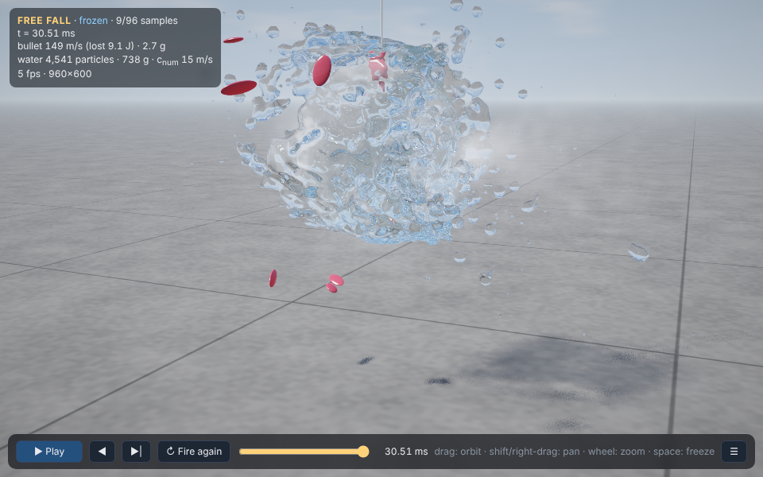
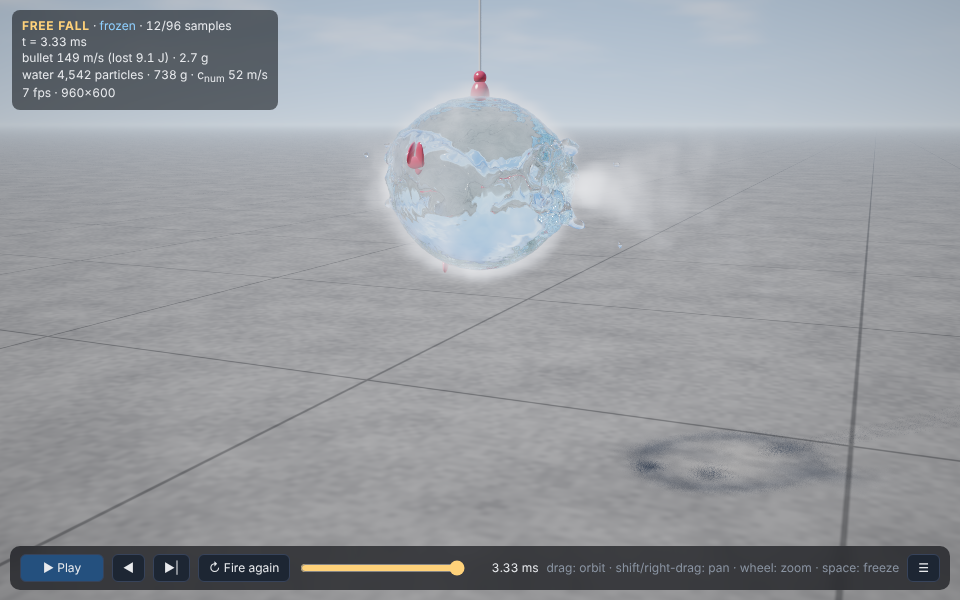
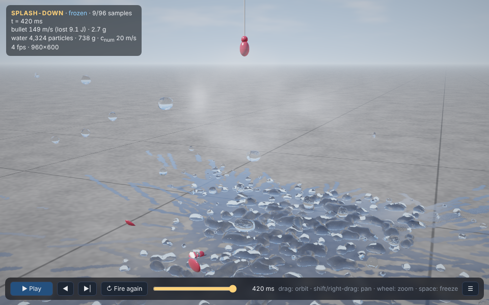

# Bullet vs. Water Balloon

A ray-traced, physically simulated bullet piercing a water balloon, in **one HTML file**: JavaScript, HTML, CSS and WebGL2. No frameworks, no libraries, no external dependencies.

**[▶ Run the live demo](https://az9713.github.io/fable-5.2-demos/)**

*Click the image to open the live simulation. GitHub does not allow a README to embed a running web page, so the demo is served from GitHub Pages.*

## Where the prompt comes from

The prompt is the water-balloon test from Matthew Berman's video on Claude Fable 5.2. This repo is one model's answer to it, written by Claude Fable 5.2.

> One HTML file with JavaScript, HTML, CSS, and WebGL2 for the graphics. No frameworks. No libraries. No external dependencies.
>
> Make a ray tracing simulation of a bullet piercing through a water balloon, making the balloon pop and the water burst, deforming from its original shape and eventually falling to the ground. Make it look as realistic and physically accurate as possible.
>
> Allow me to freeze the animation at any point in time and view the scene from any angle. Add sliders for bullet speed, balloon size, lighting, gravity, and other parameters. Most important, do not use three.js or any external web libraries.

## What you see

| Membrane peeled, 3 ms | Burst, 30 ms | Splash-down, 420 ms |
| --- | --- | --- |
|  |  |  |

## Controls

| Action | How |
| --- | --- |
| Freeze / resume | Space, or the Freeze button |
| Orbit, pan, zoom | Drag, shift- or right-drag, mouse wheel (works while frozen) |
| Replay any moment | Drag the timeline, or ← / → |
| Fire again | R |
| Hide the panel | H |

While frozen, the image refines to 96 samples at full resolution with anti-aliasing and soft shadows.

Sliders cover bullet speed, calibre and aim offset, balloon radius and height, rubber retraction speed, gravity, viscosity, cohesion, air drag, mist, sun angle and intensity, sky, exposure, refractive index, and rubber opacity and hue.

## How it works

**Physics (JavaScript, CPU)**

- **Water:** about 4,500 particles of weakly compressible smoothed-particle hydrodynamics (SPH). During the impact the sound speed is the real 1,480 m/s, so timesteps are about 1 µs. Afterwards it relaxes to about 7× the bulk flow speed so the fall finishes in reasonable time.
- **Bullet:** a rigid round-nosed slug. The energy it loses equals the kinetic energy it gives the water.
- **Rubber:** tears spread from the entry and exit holes at the retraction speed in a petal pattern. Intact rubber presses on the water at about 2.5 kPa, and the peeling rim strips mist off the surface.
- **Aftermath:** spray feels quadratic air drag, the ground is inelastic with friction, and landing water leaves a wet footprint.

**Rendering (WebGL2 fragment shader)**

- Particles are splatted into a 3D density texture each frame; rays march to its iso-surface.
- Each ray gets Fresnel reflection, Snell refraction through multiple interfaces, total internal reflection and Beer–Lambert absorption.
- The bullet, membrane, rubber scraps, string and ground are intersected analytically. Mist is a scattering volume.

## Where the physics is approximate

- **Bullet smaller than the grid:** particle spacing is about 5.5 mm, so the bullet is sub-resolution. The coupling is calibrated to energy, not momentum, so the water gets roughly twice the forward momentum the bullet loses.
- **Drag comes out low:** the effective drag coefficient is about 0.16, against roughly 0.3 for a real round-nosed bullet in water.
- **Marble-sized droplets:** the smallest droplet is one particle, so breakup produces marbles where real water makes sheets and ligaments. The 7,700-particle setting helps at about twice the CPU cost.
- **Cohesion is a stand-in:** surface tension is a small allowed negative pressure, not a real surface-tension model.
- **Shadow caustics are faked:** the bright centre of the water's shadow is a thickness-based approximation.
- **Membrane is kinematic:** the tear front is an analytic function of time, not a simulated elastic sheet.

## Running it locally

Open `index.html` in a desktop browser with WebGL2 and a real GPU. A full shot takes roughly 8,000 solver steps, so expect 20–40 seconds depending on your CPU. If the frame rate is poor, lower "Live resolution" or choose the 2,400-particle setting.
